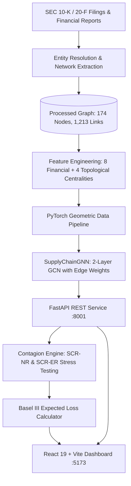

# Supply Chain Network Credit Contagion (SCNCC)

[](#)
[](#)
[](#)
[](#)
[](#)

A quantitative credit risk framework modeling systemic default contagion across the global automotive manufacturing network using Graph Neural Networks (GNNs) and Basel III regulatory capital formulations.

[Interactive Dashboard](https://vardhan-19.github.io/Supply-Chain-Network-Credit-Contagion/) • [Technical Monograph](SUMMARY.md) • [Project Report (PDF)](docs/SCNCC_Project_Report.pdf)

---

## 1. Executive Overview

Traditional corporate credit rating methodologies (e.g., Altman Z-Score, Merton structural models) evaluate entities in isolation using static balance sheet ratios. Modern corporate insolvencies, however, are fundamentally network-propagated: distress at a critical Tier-1 component manufacturer cascades through trade credit exposures, component shortages, and operational bottlenecks to counterparties globally.

Grounded in recent econometric and graph machine learning research (**Mojdehi et al., 2025**; **Liu, 2025**; **Geng et al., 2024**), **Supply Chain Network Credit Contagion (SCNCC)** models the global automotive ecosystem as a directed, edge-weighted property graph:
- **174 Automotive Corporations**: Global OEMs, Tier-1 module conglomerates, Tier-2 semiconductor fabricators, and battery manufacturers.
- **1,213 Directed Dependencies**: Commercial supply flows, trade credit balances, and equity ownership relationships (modeled following Liu, 2025).
- **Graph Neural Network (GNN)**: A 2-layer Graph Convolutional Network (`GCNConv`) combining 12 non-leaking financial and topological features (Mojdehi et al., 2025) with temporal decay transmission weights (Geng et al., 2024).
- **Systemic Contagion Simulation**:
  - **SCR-NR (Node Default Shock)**: Simulates total corporate liquidation and incident edge severance.
  - **SCR-ER (Edge Severance Shock)**: Simulates targeted bilateral supply embargoes or contract terminations.
- **Interactive Cockpit**: 2D force-directed WebGL dashboard for real-time portfolio exploration, stress testing, and Basel III expected loss calculations.

---

## 2. System Architecture



---

## 3. Mathematical & Econometric Foundations

The quantitative foundations of SCNCC synthesize classical credit risk benchmarks with recent advancements in supply chain graph neural networks and dynamic default contagion.

### 3.1 Ground Truth Default Formulation (Altman Z)
Ground truth financial distress supervision is established via the classical manufacturing discriminant formulation of **Altman (1968, 1983)**:

$$
Z = 1.2 X_1 + 1.4 X_2 + 3.3 X_3 + 0.6 X_4 + 1.0 X_5
$$

Where:
- $X_1 = \text{Working Capital} / \text{Total Assets}$ (Short-term liquidity)
- $X_2 = \text{Retained Earnings} / \text{Total Assets}$ (Cumulative profitability)
- $X_3 = \text{EBIT} / \text{Total Assets}$ (Operating efficiency)
- $X_4 = \text{Market Cap} / \text{Total Debt}$ (Market leverage)
- $X_5 = \text{Revenue} / \text{Total Assets}$ (Asset turnover)

**Classification Threshold:**
- $Z \le 1.81 \implies \text{Distress Zone} \implies y = 1$
- $Z > 1.81 \implies \text{Safe / Grey Zone} \implies y = 0$

### 3.2 Transmission Weight & Temporal Decay ($w_{ij}$)
Following the credit risk contagion dynamics of **Geng, Han, Yang, & Zhao (PLoS ONE, 2024)** and the multi-relational enterprise relationship weighting of **Liu (ACM AIDF, 2025)**, the edge contagion transmission coefficient $w_{ij} \in [0, 1]$ models the proportion of economic distress propagated from supplier $i$ to buyer $j$:

$$
C_{ij}^* = \frac{\ln(1 + C_{ij})}{\max_{(u,v)} \ln(1 + C_{uv})}
$$

$$
S_{ij} = \text{Confidence}_{ij} + 1.0 \cdot \text{Ownership}_{ij} + 0.5 \cdot C_{ij}^*
$$

$$
D_{ij} = \exp\left(-0.20 \times (2025 - t_{ij})\right)
$$

$$
w_{ij} = \text{Normalize}\left(S_{ij} \times D_{ij}\right)
$$

Where:
- $C_{ij}$: Bilateral trade credit volume in USD (following Geng et al., 2024).
- $S_{ij}$: Commercial dependency transmission score across supply and equity ownership links (following Liu, 2025).
- $D_{ij}$: Exponential temporal decay factor ($t_{ij} \in [2020, 2025]$) discounting aged relationship disclosures (Geng et al., 2024).
- $w_{ij}$: Min-max normalized contagion propagation weight in $[0, 1]$ passed into the GNN message passing layers.

### 3.3 Basel III Credit Risk & Systemic Expected Loss
Under the **Basel Committee on Banking Supervision (2017)** Foundation Internal Ratings-Based (F-IRB) framework and network systemic clearing formulations (Eisenberg & Noe, 2001; Gai & Kapadia, 2010):

- **Exposure at Default (EAD):** Standard turnover proxy calibrated to operating scale:
$$
\text{EAD}_i = 0.15 \times \text{Revenue}_i
$$

- **Loss Given Default (LGD):** Senior unsecured recovery calibration:
$$
\text{LGD} = 0.45
$$

- **Baseline Expected Loss (EL):**
$$
\text{EL}_i = \text{PD}_i \times \text{LGD} \times \text{EAD}_i
$$

- **Systemic Risk Contribution ($\Delta \text{EL}$):** Net incremental dollar distress transmitted downstream to counterparties (excluding target entity $k$):
$$
\Delta \text{EL}_{\text{systemic}} = \sum_{k \neq \text{target}} \max\left(0, \; \text{EL}_k^{\text{shocked}} - \text{EL}_k^{\text{baseline}}\right)
$$

---

## 4. Input Features (12 Non-Leaking Predictors)

Grounded in the hybrid topological and financial feature paradigm established by **Mojdehi, Amiri, and Haddadi (IEEE Access, 2025)**, the model integrates 8 balance sheet ratios with 4 network topological centralities. To guarantee non-trivial structural learning and prevent label leakage, `altman_z_score` and `default_label` are strictly excluded from model inputs:

| # | Feature Name | Domain | Structural Significance | Methodological Reference |
|:---:|---|---|---|---|
| 1 | `revenue` | Financial | Operating scale (USD) | Corporate Scale Benchmark |
| 2 | `total_debt` | Financial | Total obligations (USD) | Solvency Claim Benchmark |
| 3 | `market_cap` | Financial | Market equity value (USD) | Equity Buffer (Merton, 1974) |
| 4 | `current_ratio` | Financial | Short-term liquidity buffer | Working Capital Coverage |
| 5 | `debt_to_equity` | Financial | Capital structure leverage | Financial Risk Multiplier |
| 6 | `profit_margin` | Financial | Operating profitability | Operating Efficiency |
| 7 | `revenue_growth` | Financial | YoY revenue expansion rate | Growth Trajectory |
| 8 | `roa` | Financial | Return on assets efficiency | Asset Productivity |
| 9 | `betweenness_centrality` | Topological | Network bottleneck / bridge role | Mojdehi et al. (IEEE Access, 2025) |
| 10 | `eigenvector_centrality` | Topological | Connectivity to influential counterparties | Mojdehi et al. (IEEE Access, 2025) |
| 11 | `pagerank` | Topological | Transit influence score | Mojdehi et al. (IEEE Access, 2025) |
| 12 | `clustering_coefficient` | Topological | Local supply triangle redundancy | Mojdehi et al. (IEEE Access, 2025) |

**Empirical Validation:** As demonstrated by Mojdehi et al. (2025), combining graph centralities with financial accounting metrics significantly outperforms isolated classifiers (e.g. Logistic Regression) by providing the GNN with structural context on counterparty dependencies and chokepoints.

---

## 5. Empirical Findings

Stress testing across 16 sample entities and 18 commercial edges reveals:
1. **Semiconductor Concentration Risk:** Insolvency of TSMC Arizona induces a **$51.10B** systemic expected loss surge across 67 downstream manufacturers, reflecting concentrated microchip dependency.
2. **Tier-1 Contagion Cascades:** Liquidating Continental AG produces an immediate **+24.02% default probability jump** in immediate counterparties.
3. **Peripheral Node Insulation:** Divisions with low downstream out-degree (e.g., Ram Trucks, Lamborghini) register **$0.00** systemic transmission, confirming topological selectivity.
4. **Contract Severance Asymmetry:** Severing the Onsemi $\to$ Valeo link generates **$2.96B** in losses, whereas diversified supply lines (e.g., Panasonic $\to$ Tesla) are absorbed without systemic impact.

---

## 6. Installation & Quickstart

### Environment Setup

#### Option A: Conda
```bash
git clone https://github.com/vardhan-19/Supply-Chain-Network-Credit-Contagion.git
cd Supply-Chain-Network-Credit-Contagion
conda env create -f environment.yml
conda activate scncc_env
npm --prefix frontend install
```

#### Option B: Pip
```bash
git clone https://github.com/vardhan-19/Supply-Chain-Network-Credit-Contagion.git
cd Supply-Chain-Network-Credit-Contagion
pip install -r requirements.txt
npm --prefix frontend install
```

### Running Locally
```bash
npm run dev
```
- **Dashboard:** `http://localhost:5173`
- **API Documentation:** `http://localhost:8001/docs`
- **Health Check:** `http://localhost:8001/health`

### Automated Testing
```bash
pytest
```

---

## 7. Repository Structure

```
Supply-Chain-Network-Credit-Contagion/
├── README.md                    # Project documentation & architecture
├── SUMMARY.md                   # Mathematical monograph & proofs
├── pytest.ini                   # Pytest discovery configuration
├── requirements.txt             # Pip dependency specifications
├── environment.yml              # Conda environment specifications
├── package.json                 # Dev process orchestrator
├── api/
│   ├── main.py                  # FastAPI REST service
│   └── __init__.py
├── model/
│   ├── gnn_model.py             # SupplyChainGNN (GCNConv with edge weights)
│   ├── gnn_dataset.py           # PyG dataset constructor & feature scaler
│   ├── train_gnn.py             # Class-weighted NLL training pipeline
│   ├── baseline_model.py        # Isolated logistic regression baseline
│   └── evaluation/              # Benchmark validation metrics
├── simulation/
│   ├── shock.py                 # SCR-NR and SCR-ER graph mutation operators
│   ├── risk_metrics.py          # Basel III EAD/EL and systemic loss metrics
│   └── stress_test.py           # Contagion simulation orchestrator
├── graph/
│   ├── build_graph.py           # NetworkX graph constructor
│   └── network_metrics.py       # Centrality computation routines
├── frontend/                    # React 19 + WebGL dashboard
├── data/
│   ├── raw/anchor_companies.csv # Reference seed company dataset
│   └── processed/               # Multi-relational edge & feature matrices
├── tests/
│   ├── test_api.py              # REST API endpoint and contract tests
│   ├── test_simulation.py       # Stress testing & risk calculation tests
│   └── test_graph.py            # Graph construction and centrality tests
└── docs/
    └── SCNCC_Project_Report.pdf # Academic monograph (PDF)
```

---

## 8. Academic References & Literature Citations

The mathematical formulations, network structures, and contagion dynamics in SCNCC are directly grounded in the following foundational literature:

### 8.1 Primary Research Papers & Methodological Foundations

1. **Mojdehi, K. F., Amiri, B., & Haddadi, A. (2025).** *A Novel Hybrid Model for Credit Risk Assessment of Supply Chain Finance Based on Topological Data Analysis and Graph Neural Network.* **IEEE Access**, vol. 13, pp. 11094–11116. [doi:10.1109/ACCESS.2025.3528373](https://doi.org/10.1109/ACCESS.2025.3528373)
   - *Framework taken:* Hybrid feature integration combining 8 firm accounting ratios with 4 network topological centralities (betweenness, eigenvector, PageRank, clustering coefficient) into GNN input tensors, and proof of topological importance in default prediction.

2. **Liu, K. (2025).** *Construction of Enterprise Credit Risk Assessment Model Driven by Graph Neural Network.* In **Proceedings of the 2025 International Conference on Artificial Intelligence and Digital Finance (AIDF 2025)**, Chengdu, China, ACM, pp. 1–6. [doi:10.1145/3764727.3764741](https://doi.org/10.1145/3764727.3764741)
   - *Framework taken:* Heterogeneous multi-tier automotive supply network graph formulation (OEMs, Tier-1, Tier-2), edge weighting via commercial trade flows and equity ownership, and collaborative risk perception.

3. **Geng, X., Han, B., Yang, D., & Zhao, J. (2024).** *Credit risk contagion of supply chain finance: An empirical analysis of supply chain listed companies.* **PLoS ONE**, vol. 19, no. 7, p. e0306724. [doi:10.1371/journal.pone.0306724](https://doi.org/10.1371/journal.pone.0306724)
   - *Framework taken:* Stochastic default contagion dynamics across listed supply chain companies, asymmetric transmission mechanisms (upstream physical delivery vs. downstream trade credit receivables), and temporal decay discounting of relationship disclosures.

### 8.2 Foundational Financial, Regulatory & GNN Baselines

4. **Altman, E. I. (1968).** *Financial Ratios, Discriminant Analysis and the Prediction of Corporate Bankruptcy.* **The Journal of Finance**, vol. 23, no. 4, pp. 589–609. [doi:10.1111/j.1540-6261.1968.tb00843.x](https://doi.org/10.1111/j.1540-6261.1968.tb00843.x)
   - *Framework taken:* Classical manufacturing Z-Score discriminant function and benchmark distress threshold ($Z \le 1.81$).

5. **Basel Committee on Banking Supervision (2017).** *High-level summary of Basel III: A global regulatory framework for more resilient banks and banking systems.* Bank for International Settlements (BIS).
   - *Framework taken:* Foundation Internal Ratings-Based (F-IRB) parameters: Exposure at Default ($\text{EAD} = 0.15 \times \text{Revenue}$), Loss Given Default ($\text{LGD} = 0.45$), and Expected Loss ($\text{EL} = \text{PD} \times \text{LGD} \times \text{EAD}$).

6. **Kipf, T. N., & Welling, M. (2017).** *Semi-Supervised Classification with Graph Convolutional Networks.* In **Proceedings of the 5th International Conference on Learning Representations (ICLR 2017)**.
   - *Framework taken:* First-order Chebyshev spectral graph convolution operator $\mathbf{\tilde{D}}^{-1/2} \mathbf{\tilde{A}} \mathbf{\tilde{D}}^{-1/2}$ utilized in `SupplyChainGNN`.

7. **Eisenberg, L., & Noe, T. H. (2001).** *Systemic risk in financial systems.* **Management Science**, vol. 47, no. 2, pp. 236–249. [doi:10.1287/mnsc.47.2.236.9835](https://doi.org/10.1287/mnsc.47.2.236.9835)
   - *Framework taken:* Clearing vector formulation for multi-obligor network systemic risk.

8. **Gai, P., & Kapadia, S. (2010).** *Contagion in financial networks.* **Proceedings of the Royal Society A**, vol. 466, no. 2120, pp. 2401–2423. [doi:10.1098/rspa.2009.0410](https://doi.org/10.1098/rspa.2009.0410)
   - *Framework taken:* Network fragility, connectivity thresholds, and shock propagation dynamics.

9. **Acemoglu, D., Ozdaglar, A., & Tahbaz-Salehi, A. (2015).** *Systemic risk and stability in financial networks.* **American Economic Review**, vol. 105, no. 2, pp. 564–608. [doi:10.1257/aer.20130456](https://doi.org/10.1257/aer.20130456)
   - *Framework taken:* Macroeconomic volatility amplification across inter-firm input-output network linkages.

10. **Merton, R. C. (1974).** *On the Pricing of Corporate Debt: The Risk Structure of Interest Rates.* **The Journal of Finance**, vol. 29, no. 2, pp. 449–470. [doi:10.1111/j.1540-6261.1974.tb03058.x](https://doi.org/10.1111/j.1540-6261.1974.tb03058.x)
    - *Framework taken:* Option-theoretic structural default threshold and equity market valuation buffer.

### 8.3 Comparative Theoretical Synthesis

| Dimension | Mojdehi et al. (2025) | Liu (2025) | Geng et al. (2024) | SCNCC Framework (Ours) |
|---|---|---|---|---|
| **Industry Domain** | Supply Chain Finance / SMEs | 800 Listed Auto Enterprises | Listed Supply Chain Firms | Global Multi-Tier Automotive Ecosystem |
| **Network Scale** | Regional SME Network | 800 Nodes | Listed Corporate Pairs | 174 Multi-Tier Firms, 1,213 Edges |
| **Edge Semantics** | Proximity / Distance Graph | Multi-Relational (Supply, Equity) | Bilateral Trade Credit Links | Directed Supply, Trade Credit, Ownership |
| **Edge Weighting** | Topological Adjacency | Attention Coefficients | Coupled Jump Intensity | Calibrated Transmission with Exponential Time Decay |
| **Predictor Set** | Accounting + TDA/Centralities | 20 Accounting Ratios | Micro Ratios + Macro Factors | 8 Accounting + 4 Topological Centralities |
| **Model Architecture**| BallMapper + GNN Hybrid | Graph Attention Network (GAT) | Cox-Copula Stochastic Model | Edge-Weighted Graph Convolutional Network (`GCNConv`) |
| **Stress Testing** | None (Static Classification) | None (Static Classification) | Dynamic Hazard Rate Jumps | Dynamic SCR-NR (Node Default) & SCR-ER (Edge Severance) |
| **Regulatory Metrics**| Accuracy / F1-Score | Weighted F1 / AUC-ROC | Contagion Probability | Basel III F-IRB Expected Loss ($\Delta \text{EL}$) & Systemic Loss (\$M) |
