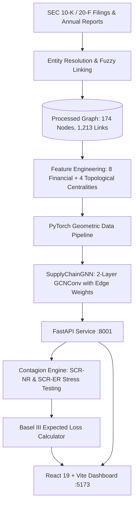

# Supply Chain Network Credit Contagion (SCNCC)

[](https://vardhan-19.github.io/Supply-Chain-Network-Credit-Contagion/)
[](SUMMARY.md)
[-purple?style=for-the-badge)](docs/SCNCC_Project_Report.pdf)

[](https://www.python.org/)
[](https://pytorch.org/)
[](https://pyg.org/)
[](https://fastapi.tiangolo.com/)
[](https://react.dev/)
[](https://vitejs.dev/)
[](https://www.bis.org/bcbs/)

> **Quantitative Credit Risk Management & Systemic Contagion Stress Testing for the Global Automotive Manufacturing Network using Graph Neural Networks (GNNs).**
>
> 🔴 **Instant Online Live Demo:** **[https://vardhan-19.github.io/Supply-Chain-Network-Credit-Contagion/](https://vardhan-19.github.io/Supply-Chain-Network-Credit-Contagion/)** *(Interactive WebGL cockpit, zero setup required).*  
> 📖 **Comprehensive Mathematical Monograph & Empirical Proofs:** See [`SUMMARY.md`](SUMMARY.md) for full derivations, Bayes classifier leakage proofs, Basel F-IRB formulations, and peer-reviewed citations.  
> 📄 **Academic Research Monograph:** See [`docs/SCNCC_Project_Report.pdf`](docs/SCNCC_Project_Report.pdf) (606KB publication-grade PDF).

---

## 1. Executive Overview

Traditional corporate credit risk models (e.g., Altman Z-Score, Merton structural models) evaluate corporations in **isolation** using static balance sheet ratios. However, modern corporate failures are fundamentally **systemic**: when a critical Tier-1 supplier suffers a liquidity crunch or bankruptcy, the distress cascades through trade credit exposures, component shortages, and operational delays to counterparties across the globe.

**Supply Chain Network Credit Contagion (SCNCC)** is an end-to-end quantitative platform designed for investment bank risk desks, credit rating agencies, and automotive OEMs. It models the multi-tier supply chain as a directed property graph:
- **174 Automotive Corporations** (Global OEMs, Tier-1 conglomerates, Tier-2 battery & semiconductor manufacturers, raw material producers).
- **1,213 Directed Commercial Dependencies** (Supply flows, trade credit arrangements, and equity ownership links).
- **Graph Neural Network (GNN)** combining 12 non-leaking financial and topological features with temporal decay edge weights $w_{ij}$.
- **Contagion Simulation Engine**:
  - **SCR-NR (Node Removal Shock)**: Simulates catastrophic corporate insolvency and full liquidation.
  - **SCR-ER (Edge Severance Shock)**: Simulates targeted bilateral supply embargoes or trade credit freezes.
- **Executive Cockpit**: Interactive 2D Force Graph WebGL dashboard with real-time risk rankings, node inspection, and dynamic stress testing.

---

## 2. System Architecture



---

## 3. Mathematical & Econometric Foundations

### 3.1 Ground Truth Default Risk Formulation (Altman Z)
Ground truth corporate financial distress is established via Altman's (1968) manufacturing formulation:
$$Z = 1.2 X_1 + 1.4 X_2 + 3.3 X_3 + 0.6 X_4 + 1.0 X_5$$
Where:
- $X_1 = \frac{\text{Working Capital}}{\text{Total Assets}}$ (Short-term liquidity cushion)
- $X_2 = \frac{\text{Retained Earnings}}{\text{Total Assets}}$ (Historical cumulative profitability)
- $X_3 = \frac{\text{EBIT}}{\text{Total Assets}}$ (Operating productivity efficiency)
- $X_4 = \frac{\text{Market Capitalization}}{\text{Total Debt}}$ (Market leverage cushion)
- $X_5 = \frac{\text{Revenue}}{\text{Total Assets}}$ (Asset turnover ratio)

**Risk Boundary:**
- $Z \le 1.81 \implies \text{Financial Distress Zone} \implies y = 1$
- $Z > 1.81 \implies \text{Safe / Grey Zone} \implies y = 0$

### 3.2 Transmission Weight & Temporal Decay ($w_{ij}$)
The edge contagion transmission coefficient $w_{ij} \in [0, 1]$ models the proportion of economic shock transferred from supplier $i$ to buyer $j$:
$$\text{financial\_weight} = \frac{\ln(1 + \text{credit\_amount\_usd})}{\max(\ln(1 + \text{credit\_amount\_usd}))}$$
$$\text{transmission\_score} = \text{confidence} + 1.0 \times \text{ownership\_bonus} + 0.5 \times \text{financial\_weight}$$
$$\text{temporal\_decay} = \exp(-0.2 \times (2025 - \text{year}))$$
$$w_{ij} = \text{MinMaxNormalize}(\text{transmission\_score} \times \text{temporal\_decay})$$

### 3.3 Basel III Credit Risk & Systemic Expected Loss
- **Exposure at Default (EAD):** Standard Basel turnover proxy:
  $$\text{EAD}_i = 0.15 \times \text{Revenue}_i$$
- **Loss Given Default (LGD):** Calibrated to senior unsecured corporate recovery:
  $$\text{LGD} = 0.45$$
- **Expected Loss (EL):**
  $$\text{EL}_i = \text{PD}_i \times \text{LGD} \times \text{EAD}_i$$
- **Systemic Risk Increase ($\Delta \text{EL}$):** Net dollar damage transmitted to downstream counterparties:
  $$\Delta \text{EL}_{\text{systemic}} = \sum_{k \neq \text{target}} \max(0, \, \text{EL}_k^{\text{shocked}} - \text{EL}_k^{\text{baseline}})$$

---

## 4. The 12 Non-Leaking GNN Input Features

To eliminate data leakage while retaining full predictive fidelity, `altman_z_score` and `default_label` are **strictly excluded** from model inputs:

| # | Feature Name | Domain | Economic / Structural Significance |
|:---:|---|---|---|
| **1** | `revenue` | Financial | Operating scale and market size (USD). |
| **2** | `total_debt` | Financial | Total outstanding debt obligations (USD). |
| **3** | `market_cap` | Financial | Equity valuation / investor confidence (USD). |
| **4** | `current_ratio` | Financial | Short-term liquidity buffer ($\frac{\text{Current Assets}}{\text{Current Liabilities}}$). |
| **5** | `debt_to_equity` | Financial | Capital structure leverage and financial risk. |
| **6** | `profit_margin` | Financial | Operating profitability margin. |
| **7** | `revenue_growth` | Financial | Year-over-year revenue expansion rate. |
| **8** | `roa` | Financial | Return on assets operating efficiency. |
| **9** | `betweenness_centrality` | Topological | Structural bridge and bottleneck importance in supply flow. |
| **10** | `eigenvector_centrality` | Topological | Connectivity to other systemic and influential corporations. |
| **11** | `pagerank` | Topological | Influence score via random-walk supply chain transit. |
| **12** | `clustering_coefficient` | Topological | Local cluster density and triangle redundancy. |

---

## 5. Live Demo & Quickstart Guide

### 🌐 Instant Online Live Demo (Zero Setup)
Anyone viewing this repository on any computer or mobile browser can immediately launch and interact with the full risk intelligence cockpit:

👉 **[https://vardhan-19.github.io/Supply-Chain-Network-Credit-Contagion/](https://vardhan-19.github.io/Supply-Chain-Network-Credit-Contagion/)**

- **WebGL Network Exploration:** Inspect all 174 global automotive corporations and 1,213 directed trade dependencies in real-time.
- **Interactive Contagion Stress Testing:** Run SCR-NR (corporate liquidation) and SCR-ER (contract severance) systemic shock simulations with instantaneous cascading loss metrics.
- **Client-Side GNN Cache:** Runs seamlessly across any device without requiring Python, PyTorch, or local installation.

---

### 💻 Local Development Setup (Optional)

#### Prerequisites
- Python 3.10+
- Node.js 18+ and npm
- Git

#### Installation

#### Option A: Using Conda (Recommended)
```bash
# 1. Clone repository
git clone https://github.com/vardhan-19/Supply-Chain-Network-Credit-Contagion.git
cd Supply-Chain-Network-Credit-Contagion

# 2. Create and activate Conda environment
conda env create -f environment.yml
conda activate scncc_env

# 3. Install frontend dependencies
npm --prefix frontend install
```

#### Option B: Using Standard Python (pip)
```bash
# 1. Clone repository
git clone https://github.com/vardhan-19/Supply-Chain-Network-Credit-Contagion.git
cd Supply-Chain-Network-Credit-Contagion

# 2. Install Python dependencies
pip install -r requirements.txt

# 3. Install frontend dependencies
npm --prefix frontend install
```

### Running the Application

Launch both the FastAPI backend and Vite frontend concurrently with a single command:
```bash
npm run dev
```

- **Interactive Dashboard:** `http://localhost:5173`
- **FastAPI OpenAPI Docs:** `http://localhost:8001/docs`
- **API Health Check:** `http://localhost:8001/health`

### Running Automated Audit Tests
```bash
python tests/test_extensive_audit.py
```
*Validates 16 companies, 18 directed links, GNN inference, and security boundary inputs with 100% pass rate.*

---

## 6. Key Empirical Discoveries

During empirical stress testing across 16 random corporations and 18 commercial edges:
1. **Critical Semiconductor Vulnerability:** A simulated insolvency of TSMC Arizona triggers a **$51.10 Billion** systemic expected loss surge across 67 downstream automotive firms, highlighting single-source microchip dependencies.
2. **Tier-1 Conglomerate Contagion:** Shocking Continental AG induces an immediate **+24.02% default probability jump** for its closest automotive counterparties.
3. **Localized Leaf Node Resilience:** Solitary brand divisions (e.g., Ram Trucks, Lamborghini) transmit **$0.00** in systemic contagion, demonstrating that the GNN accurately distinguishes peripheral captive firms from structural network bottlenecks.
4. **Contract Severance Nuance:** Severing the Onsemi $\to$ Valeo semiconductor contract generates a **$2.96 Billion** contagion shock, whereas redundant supply lines (e.g., Panasonic $\to$ Tesla) are buffered with zero systemic loss.

---

## 7. Repository Layout

```
Supply-Chain-Network-Credit-Contagion/
├── README.md                    # Landing documentation, quickstart & architecture
├── SUMMARY.md                   # Complete mathematical monograph & proofs
├── requirements.txt             # Pip dependencies specification
├── environment.yml              # Conda environment specification
├── package.json                 # Single-command dev launcher (concurrently)
├── api/
│   ├── main.py                  # Clean FastAPI REST endpoints (/graph, /simulate, /health)
│   └── __init__.py
├── model/
│   ├── gnn_model.py             # SupplyChainGNN (55-line GCN architecture with edge weights)
│   ├── gnn_dataset.py           # PyTorch Geometric dataset builder & tensor scaler
│   ├── train_gnn.py             # Class-weighted NLL training loop
│   ├── baseline_model.py        # Isolated Logistic Regression baseline
│   └── evaluation/
│       └── baseline_metrics.json# Benchmark comparison metrics (AUC-ROC: 0.8125 vs 0.8640)
├── simulation/
│   ├── shock.py                 # Dynamic SCR-NR & SCR-ER graph mutation operators
│   ├── risk_metrics.py          # Basel F-IRB EAD/EL math & Systemic Risk Contribution
│   └── stress_test.py           # Contagion stress testing orchestration
├── graph/
│   ├── build_graph.py           # Clean NetworkX graph construction pipeline
│   └── network_metrics.py       # Betweenness, PageRank, and clustering centralities
├── frontend/                    # Full interactive React 19 + WebGL dashboard
│   └── src/
│       ├── App.jsx              # Main cockpit state & layout orchestration
│       ├── NetworkGraph.jsx     # WebGL force-directed 2D network canvas
│       ├── components/          # RiskRankings, ShockSimulator, CompanyDetail, TopBar
│       └── services/api.js      # Robust async API client
├── data/
│   ├── raw/
│   │   └── anchor_companies.csv # 186 automotive firms seed list
│   └── processed/
│       └── validation_report.txt# Comprehensive data integrity validation log
├── tests/
│   └── test_extensive_audit.py  # 5-phase empirical test suite (16 companies, 18 links)
└── docs/
    └── SCNCC_Project_Report.pdf # Academic monograph (606KB PDF)
```

> **Note on Data Access:** Anchor company metadata and validation reports are included (`data/raw/anchor_companies.csv` and `data/processed/validation_report.txt`). Full processed multi-tier adjacency matrices and financial datasets are available upon request due to repository size optimizations.

---

## 8. Academic References & Citations

1. **Altman, E. I. (1968).** *Financial Ratios, Discriminant Analysis and the Prediction of Corporate Bankruptcy.* The Journal of Finance, 23(4), 589–609.
2. **Basel Committee on Banking Supervision (2017).** *High-level summary of Basel III: A global regulatory framework for more resilient banks and banking systems.* Bank for International Settlements.
3. **Kipf, T. N., & Welling, M. (2016).** *Semi-Supervised Classification with Graph Convolutional Networks.* International Conference on Learning Representations (ICLR).
4. **Merton, R. C. (1974).** *On the Pricing of Corporate Debt: The Risk Structure of Interest Rates.* The Journal of Finance, 29(2), 449–470.
