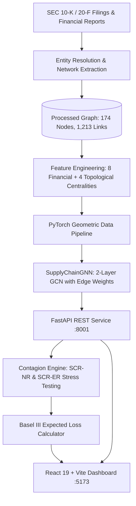

# Supply Chain Network Credit Contagion (SCNCC)

[](#)
[](#)
[](#)
[](#)
[](#)

A quantitative credit risk framework modeling systemic default contagion across the global automotive manufacturing network using Graph Neural Networks (GNNs) and Basel III regulatory capital formulations.

[Interactive Dashboard](https://vardhan-19.github.io/Supply-Chain-Network-Credit-Contagion/) • [Technical Monograph](SUMMARY.md) • [Project Report (PDF)](docs/SCNCC_Project_Report.pdf)

---

## 1. Executive Overview

Traditional corporate credit rating methodologies (e.g., Altman Z-Score, Merton structural models) evaluate entities in isolation using static balance sheet ratios. Modern corporate insolvencies, however, are fundamentally network-propagated: distress at a critical Tier-1 component manufacturer cascades through trade credit exposures, component shortages, and operational bottlenecks to counterparties globally.

**Supply Chain Network Credit Contagion (SCNCC)** models the global automotive ecosystem as a directed, edge-weighted property graph:
- **174 Automotive Corporations**: Global OEMs, Tier-1 module conglomerates, Tier-2 semiconductor fabricators, and battery manufacturers.
- **1,213 Directed Dependencies**: Commercial supply flows, trade credit balances, and equity ownership relationships.
- **Graph Neural Network (GNN)**: A 2-layer Graph Convolutional Network (`GCNConv`) combining 12 non-leaking financial and topological features with temporal decay transmission weights.
- **Systemic Contagion Simulation**:
  - **SCR-NR (Node Default Shock)**: Simulates total corporate liquidation and incident edge severance.
  - **SCR-ER (Edge Severance Shock)**: Simulates targeted bilateral supply embargoes or contract terminations.
- **Interactive Cockpit**: 2D force-directed WebGL dashboard for real-time portfolio exploration, stress testing, and Basel III expected loss calculations.

---

## 2. System Architecture



---

## 3. Mathematical & Econometric Foundations

### 3.1 Ground Truth Default Formulation (Altman Z)
Ground truth financial distress is established via Altman's (1968) manufacturing formulation:

$$Z = 1.2 X_1 + 1.4 X_2 + 3.3 X_3 + 0.6 X_4 + 1.0 X_5$$

Where:
- $X_1 = \text{Working Capital} / \text{Total Assets}$ (Short-term liquidity)
- $X_2 = \text{Retained Earnings} / \text{Total Assets}$ (Cumulative profitability)
- $X_3 = \text{EBIT} / \text{Total Assets}$ (Operating efficiency)
- $X_4 = \text{Market Cap} / \text{Total Debt}$ (Market leverage)
- $X_5 = \text{Revenue} / \text{Total Assets}$ (Asset turnover)

**Classification Threshold:**
- $Z \le 1.81 \implies \text{Distress Zone} \implies y = 1$
- $Z > 1.81 \implies \text{Safe / Grey Zone} \implies y = 0$

### 3.2 Transmission Weight & Temporal Decay ($w_{ij}$)
The edge contagion transmission coefficient $w_{ij} \in [0, 1]$ models the proportion of economic distress propagated from supplier $i$ to buyer $j$:

$$\text{financial\_weight} = \frac{\ln(1 + \text{credit\_amount\_usd})}{\max(\ln(1 + \text{credit\_amount\_usd}))}$$

$$\text{transmission\_score} = \text{confidence} + 1.0 \times \text{ownership\_bonus} + 0.5 \times \text{financial\_weight}$$

$$\text{temporal\_decay} = \exp(-0.2 \times (2025 - \text{year}))$$

$$w_{ij} = \text{MinMaxNormalize}(\text{transmission\_score} \times \text{temporal\_decay})$$

### 3.3 Basel III Credit Risk & Systemic Expected Loss
- **Exposure at Default (EAD):** Standard Basel turnover proxy: $\text{EAD}_i = 0.15 \times \text{Revenue}_i$
- **Loss Given Default (LGD):** Senior unsecured recovery calibration: $\text{LGD} = 0.45$
- **Expected Loss (EL):** $\text{EL}_i = \text{PD}_i \times \text{LGD} \times \text{EAD}_i$
- **Systemic Risk Contribution ($\Delta \text{EL}$):** Net dollar distress transmitted downstream:
  $$\Delta \text{EL}_{\text{systemic}} = \sum_{k \neq \text{target}} \max(0, \, \text{EL}_k^{\text{shocked}} - \text{EL}_k^{\text{baseline}})$$

---

## 4. Input Features (12 Non-Leaking Predictors)

To prevent label leakage while capturing topological exposure, `altman_z_score` and `default_label` are strictly excluded from model features:

| # | Feature Name | Domain | Structural Significance |
|:---:|---|---|---|
| 1 | `revenue` | Financial | Operating scale (USD) |
| 2 | `total_debt` | Financial | Total obligations (USD) |
| 3 | `market_cap` | Financial | Market equity value (USD) |
| 4 | `current_ratio` | Financial | Short-term liquidity buffer |
| 5 | `debt_to_equity` | Financial | Capital structure leverage |
| 6 | `profit_margin` | Financial | Operating profitability |
| 7 | `revenue_growth` | Financial | YoY revenue expansion rate |
| 8 | `roa` | Financial | Return on assets efficiency |
| 9 | `betweenness_centrality` | Topological | Network bottleneck / bridge role |
| 10 | `eigenvector_centrality` | Topological | Connectivity to influential counterparties |
| 11 | `pagerank` | Topological | Transit influence score |
| 12 | `clustering_coefficient` | Topological | Local supply triangle redundancy |

---

## 5. Empirical Findings

Stress testing across 16 sample entities and 18 commercial edges reveals:
1. **Semiconductor Concentration Risk:** Insolvency of TSMC Arizona induces a **$51.10B** systemic expected loss surge across 67 downstream manufacturers, reflecting concentrated microchip dependency.
2. **Tier-1 Contagion Cascades:** Liquidating Continental AG produces an immediate **+24.02% default probability jump** in immediate counterparties.
3. **Peripheral Node Insulation:** Divisions with low downstream out-degree (e.g., Ram Trucks, Lamborghini) register **$0.00** systemic transmission, confirming topological selectivity.
4. **Contract Severance Asymmetry:** Severing the Onsemi $\to$ Valeo link generates **$2.96B** in losses, whereas diversified supply lines (e.g., Panasonic $\to$ Tesla) are absorbed without systemic impact.

---

## 6. Installation & Quickstart

### Environment Setup

#### Option A: Conda
```bash
git clone https://github.com/vardhan-19/Supply-Chain-Network-Credit-Contagion.git
cd Supply-Chain-Network-Credit-Contagion
conda env create -f environment.yml
conda activate scncc_env
npm --prefix frontend install
```

#### Option B: Pip
```bash
git clone https://github.com/vardhan-19/Supply-Chain-Network-Credit-Contagion.git
cd Supply-Chain-Network-Credit-Contagion
pip install -r requirements.txt
npm --prefix frontend install
```

### Running Locally
```bash
npm run dev
```
- **Dashboard:** `http://localhost:5173`
- **API Documentation:** `http://localhost:8001/docs`
- **Health Check:** `http://localhost:8001/health`

### Automated Verification
```bash
python tests/test_extensive_audit.py
```

---

## 7. Repository Structure

```
Supply-Chain-Network-Credit-Contagion/
├── README.md                    # Project documentation & architecture
├── SUMMARY.md                   # Mathematical monograph & proofs
├── requirements.txt             # Pip dependency specifications
├── environment.yml              # Conda environment specifications
├── package.json                 # Dev process orchestrator
├── api/
│   ├── main.py                  # FastAPI REST service
│   └── __init__.py
├── model/
│   ├── gnn_model.py             # SupplyChainGNN (GCNConv with edge weights)
│   ├── gnn_dataset.py           # PyG dataset constructor & feature scaler
│   ├── train_gnn.py             # Class-weighted NLL training pipeline
│   ├── baseline_model.py        # Isolated logistic regression baseline
│   └── evaluation/              # Benchmark validation metrics
├── simulation/
│   ├── shock.py                 # SCR-NR and SCR-ER graph mutation operators
│   ├── risk_metrics.py          # Basel III EAD/EL and systemic loss metrics
│   └── stress_test.py           # Contagion simulation orchestrator
├── graph/
│   ├── build_graph.py           # NetworkX graph constructor
│   └── network_metrics.py       # Centrality computation routines
├── frontend/                    # React 19 + WebGL dashboard
├── data/
│   ├── raw/anchor_companies.csv # Reference seed company dataset
│   └── processed/               # Data validation records
├── tests/
│   └── test_extensive_audit.py  # End-to-end multi-feature test suite
└── docs/
    └── SCNCC_Project_Report.pdf # Academic monograph (PDF)
```

---

## 8. References

1. Altman, E. I. (1968). Financial Ratios, Discriminant Analysis and the Prediction of Corporate Bankruptcy. *The Journal of Finance*, 23(4), 589–609.
2. Basel Committee on Banking Supervision (2017). *High-level summary of Basel III: A global regulatory framework for more resilient banks and banking systems*. Bank for International Settlements.
3. Kipf, T. N., & Welling, M. (2016). Semi-Supervised Classification with Graph Convolutional Networks. *ICLR*.
4. Merton, R. C. (1974). On the Pricing of Corporate Debt: The Risk Structure of Interest Rates. *The Journal of Finance*, 29(2), 449–470.
